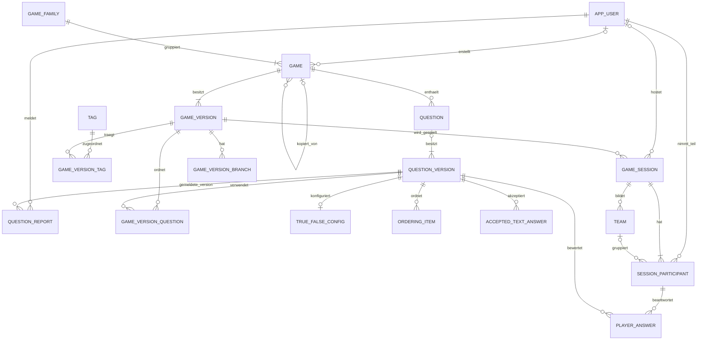

# Datenmodell Version 1

Stand: 3. November 2026
Status: Aktualisierter fachlicher Entwurf; Umsetzung läuft separat, noch kein Nachweis einer fertigen Datenbank

Die fünf Fragerunden mit Davids Antworten, späteren Korrekturen und den noch
offenen Detailfragen sind in
[`datenmodell-entscheidungen.md`](datenmodell-entscheidungen.md) dokumentiert.

Eine eigenständige, renderbare PlantUML-Darstellung liegt in
[`datenmodell-v1.puml`](datenmodell-v1.puml). Eine zusätzliche Mermaid-Fassung
liegt in [`datenmodellGrafik.md`](datenmodellGrafik.md).

## 1. Ziel und Abgrenzung

Dieses Dokument beschreibt die erste fachliche Version des Datenmodells für die
Game-based-Learning-Plattform. Es bildet Benutzer, Spiele und Spielvarianten,
versionierte Fragen, abgeschlossene Einzel- und Mehrspieler-Runden, Antworten,
Ergebnisse, Fortschritt sowie Meldungen zu fehlerhaften Fragen ab.

Dieses Dokument beschreibt das Zielmodell und keine bereits geprüfte Migration.
Die konkrete Umsetzung und ihre Prüfungen werden im OpenSpec-Change
`database-model-foundation` und im Anwendungscode getrennt nachgewiesen.

## 2. Bestätigte Fachentscheidungen

- Die aktuelle Schulklasse eines Schülers wird beim Login aus einem Claim des
  Schul-Keycloak-Tokens übernommen.
- Jede Lehrkraft darf alle aktuellen Klassen und deren Schüler einsehen.
- Spielversionen können mehrere frei benannte Tags tragen. Ein bisheriger
  Fachname kann als Tag übernommen werden; Unterthemen können weiterhin über
  Titel, Beschreibung und Textsuche gefunden werden.
- Spiele sind entweder `PRIVATE` oder `PUBLIC`.
- Die öffentliche Spieleliste und Spieldetails sind nur nach einem Login
  zugänglich.
- Neue Spiele sind standardmäßig `PRIVATE`. Bereits vorhandene Spiele werden
  bei der Migration als `PUBLIC` übernommen.
- Nur der Ersteller oder ein Administrator darf ein Spiel bearbeiten oder
  löschen.
- Lehrkräfte und Administratoren dürfen Spiele erstellen, kopieren und Fragen
  melden.
- Schüler und Lehrkräfte dürfen öffentliche Spiele hosten. Schüler dürfen
  öffentliche Spiele außerdem alleine spielen.
- Die Ersteller-Lehrkraft darf das eigene private Spiel alleine spielen oder
  eine Runde mit Schülern hosten; beim Hosting spielt sie nicht mit.
- Lehrkräfte dürfen alleine spielen und erhalten dafür Fortschritt. Ihre
  Teilnahme an Mehrspieler-Sessions ist noch nicht entschieden.
- Administratoren dürfen im Kontext der Spielrechte alles, einschließlich des
  Zugriffs auf fremde und private Spiele.
- Die Administratoren sind die Schul-Keycloak-IT-Benutzer `it220269`,
  `it220240` und `it220265`. Bei aktivem Mitspielen erhalten sie Fortschritt,
  beim reinen Hosting nicht.
- Eine Spielkopie ist eine eigenständige Variante und bleibt über eine
  Spielfamilie mit dem Original verbunden.
- Spieltyp und Spielfamilie sind verschieden: Smart10 und Just One sind
  Spieltypen; Quizbattle und DuellUmDieWelt bleiben als Bestandswerte erhalten.
- Kopierte Fragen werden als neue, unabhängige Fragen gespeichert. Meldungen
  werden nicht auf Kopien übertragen.
- Zusätzlich zu bestehenden `single_choice`-Fragen sind Wahr/Falsch,
  Reihenfolge und Freitext vorgesehen; Bestandswerte werden nicht umgedeutet.
- Nur vollständig abgeschlossene Spielrunden samt Resultaten werden dauerhaft
  gespeichert. Unfertige und abgebrochene Runden bleiben nicht in der Datenbank.
- Ein stabiler serverseitiger Abschluss-Schlüssel verhindert, dass ein Retry
  dieselbe abgeschlossene Runde und ihren Fortschritt doppelt verbucht.
- Wer eine Runde hostet, spielt darin nicht aktiv mit und erhält allein für das
  Hosting keinen Fortschritt.
- Ergebnisse werden auch bei Teamspielen pro Spieler gespeichert.
- Alle aktiven Teilnehmer einer abgeschlossenen Runde erhalten Punkte. Die
  Plätze 1 bis 3 erhalten deutlich mehr; die genaue Berechnung ist offen.
- Bei einem Gleichstand erhalten mehrere Teams den besseren Platz; der nächste
  Platz wird übersprungen, zum Beispiel `1, 1, 3`.
- Wiederholungen geben immer die volle Punktezahl. Es gibt keinen
  Anti-Farming-Abzug.
- Singleplayer- und Multiplayer-Statistiken werden getrennt angezeigt, fließen
  aber in ein gemeinsames Gesamtlevel ein.
- Klassenstatistiken werden aus den aktuell zugeordneten Schülern berechnet.
- Änderungen gelten sofort für neue Sessions. Bereits laufende Sessions spielen
  mit der beim Start verwendeten Version fertig.
- Bereits verwendete Spiel- und Frageversionen bleiben für historische
  Ergebnisse erhalten.
- Branch-Werte und ihre Reihenfolge gehören zum unveränderlichen Spielstand.
- Wird eine gemeldete Frage gelöscht, werden die Frage und ihre Meldung
  gelöscht; benötigte historische Frageversionen bleiben entkoppelt erhalten.

## 3. Rollen und Berechtigungen

Alle in der Tabelle genannten Ansichten setzen einen Login voraus.

| Aktion | Schüler | Lehrkraft | Administrator |
|---|:---:|:---:|:---:|
| Öffentliche Spieleliste und Spieldetails sehen | Ja | Ja | Ja |
| Öffentliches Spiel alleine spielen | Ja | Ja | Ja |
| Öffentliches Spiel hosten | Ja | Ja | Ja |
| Eigenes privates Spiel alleine spielen | – | Ja | Ja |
| Eigenes privates Spiel mit Schülern hosten | – | Ja | Ja |
| Spiel erstellen | Nein | Ja | Ja |
| Öffentliches Spiel kopieren | Nein | Ja | Ja |
| Eigenes Spiel bearbeiten und löschen | Nein | Ja | Ja |
| Fremdes oder privates Spiel administrieren | Nein | Nein | Ja |
| Frage melden | Nein | Ja | Ja |
| Klassen und Schüler einsehen | Nein | Ja | Nicht entschieden |

Das bestätigte uneingeschränkte Administratorrecht gilt für den
Spielkontext. Rechte außerhalb dieses Kontexts, beispielsweise der Zugriff auf
Klassen- und Schülerdaten, werden daraus nicht abgeleitet. Ebenfalls offen ist,
wie eingeladene Schüler einer privaten Runde beitreten und welche Spieldetails
sie dabei sehen. Daraus entsteht kein allgemeiner Zugriff auf private Spiele.
Ob ein privates Spiel zusätzlich ohne Mitspieler gehostet werden kann, ist
offen. Die bestätigte Möglichkeit, es allein zu spielen, entscheidet diese
Frage nicht.

Die Adminrolle soll das Backend anhand der drei fest hinterlegten
Schul-Keycloak-Benutzernamen bestimmen. Es sind weder gesonderte Admin-Logins
noch eine Oberfläche oder Datenbankfunktion zur Rollenvergabe vorgesehen.
David nannte den Benutzernamen im `backenduser`-Array eines geprüften Tokens;
die genaue technische Claim-Auswertung muss am tatsächlich vorliegenden Token
verifiziert werden. Das ist eine geplante Rollenregel, keine Behauptung über
den aktuellen Anwendungscode.

## 4. Beziehungen im Überblick



## 5. Benutzer, Klassen und Tags

### `app_user`

| Feld | Typidee | Regeln |
|---|---|---|
| `id` | UUID | Primärschlüssel |
| `external_subject` | VARCHAR | Eindeutige Keycloak-Subject-ID |
| `username` | VARCHAR | Benutzername aus der Schulidentität; keine eigene Rollenfreigabe |
| `display_name` | VARCHAR | Anzeigename |
| `role` | ENUM | `STUDENT`, `TEACHER`, `ADMIN` |
| `school_class` | VARCHAR, NULL | Bestehendes Feld für die aktuelle Klasse, nur für Schüler relevant |
| `active` | BOOLEAN | Deaktivierte Benutzer dürfen keine geschützten Aktionen ausführen |
| `created_at` | TIMESTAMP | Erstellungszeitpunkt |
| `updated_at` | TIMESTAMP | Letzte Profilaktualisierung |

Die aktuelle Klasse wird bei jedem authentifizierten Profilabgleich aus dem
Keycloak-Claim aktualisiert. Eine eigene Klassentabelle ist für Version 1 nicht
notwendig. Eine Klasse ergibt sich aus allen aktiven Schülern mit demselben
`school_class`.

`app_user.role` bildet die für die Anwendung wirksame Rolle ab. Für `ADMIN` ist
die feste Prüfung der drei Schul-Keycloak-Benutzernamen im Backend maßgeblich;
eine in der Datenbank gespeicherte Rolle darf nicht als eigenständige Quelle
für die Vergabe oder den Entzug von Administratorrechten dienen. Die genaue
technische Ableitung des Benutzernamens aus dem Token bleibt zu prüfen.

Folge: Wechselt ein Schüler die Klasse, werden seine persönlichen Ergebnisse
künftig in der Statistik der neuen Klasse berücksichtigt. Historische
Klassenstände werden in Version 1 nicht rekonstruiert.

### `tags`

| Feld | Typidee | Regeln |
|---|---|---|
| `id` | UUID | Primärschlüssel |
| `name` | VARCHAR | Eindeutiger frei benannter Tag; bisherige Fachnamen können übernommen werden |

Tags werden über `game_version_tags` einer Spielversion zugeordnet. Eine
Spielversion kann mehrere Tags tragen; ein Tag kann mehreren Versionen
zugeordnet sein. Das bestehende `games.subject` bleibt für den bisherigen
API-Vertrag in der Übergangszeit erhalten. Tags ersetzen weder `game_type`
noch die geordneten Branches eines Spielstands.

## 6. Spiele, Spielfamilien und Versionen

### `game_families`

| Feld | Typidee | Regeln |
|---|---|---|
| `id` | UUID | Primärschlüssel |
| `created_at` | TIMESTAMP | Erstellungszeitpunkt |

Eine Spielfamilie gruppiert das Original und alle daraus entstandenen Varianten.
Die Bibliothek kann eine Familie als gemeinsamen Eintrag und darunter die für
den Benutzer sichtbaren Varianten zeigen. Die Familie ersetzt nicht den
Spieltyp. Eine zusätzliche Metatabellenarchitektur für alle Spieltypen ist
zurückgestellt.

### `games`

| Feld | Typidee | Regeln |
|---|---|---|
| `id` | String | Bestehender Primärschlüssel; keine UUID-Massenumstellung |
| `family_id` | UUID | Pflicht-FK auf `game_families` |
| `copied_from_game_id` | String, NULL | Direkte Vorlage der Kopie |
| `created_by_id` | UUID, NULL | Bestehender Ersteller-FK auf `app_user`; bei besitzerlosen Altspielen `NULL` |
| `visibility` | ENUM | `PRIVATE` oder `PUBLIC`; bei Neuanlage standardmäßig `PRIVATE` |
| `current_version_id` | UUID | Aktuell für neue Sessions verwendete Version |
| `game_type` | VARCHAR | Spieltyp, z. B. Smart10, Just One, bestehend Quizbattle oder DuellUmDieWelt |
| `subject` | VARCHAR, NULL | Legacy-Fachfeld für bisherige API-Antworten; nicht die neue Tag-Zuordnung |
| `deleted_at` | TIMESTAMP, NULL | Logisches Löschen bei historischer Nutzung oder vorhandener Kopie |
| `created_at` | TIMESTAMP | Erstellungszeitpunkt |
| `updated_at` | TIMESTAMP | Letzte Änderung |

Nur der in `created_by_id` gespeicherte Benutzer oder ein Administrator darf
das Spiel verändern. Ein besitzerloses Altspiel mit `created_by_id = NULL`
wird bei der Migration niemandem automatisch zugeordnet und darf nur von einem
Administrator verwaltet werden. Beim Kopieren entsteht ein neues
`games`-Objekt mit neuem Ersteller, aber derselben `family_id`. Kopiert wird
immer die zum Zeitpunkt des Kopierens aktuelle Version.
Ist eine Vorlage bereits kopiert, bleibt sie bei einer Löschung auch ohne
abgeschlossene Runde als logisch gelöschter Herkunftsdatensatz erhalten. Ihre
Kopien und deren Versionen werden dadurch nicht gelöscht.

Die Standardbelegung `PRIVATE` gilt für neu erstellte Spiele. Als eigene
Migrationsregel werden alle bereits vor Einführung dieser Sichtbarkeit
vorhandenen Spiele einmalig als `PUBLIC` übernommen. Diese Regel ist keine
allgemeine Datenbankvorgabe für spätere Neuanlagen.

Listen- und Detailzugriffe auf öffentliche Spiele erfordern einen
authentifizierten Benutzer. Private Spiele bleiben in der Bibliothek auf ihren
Ersteller und Administratoren beschränkt. Für Schüler, die an einer von der
Ersteller-Lehrkraft gehosteten privaten Runde teilnehmen, ist ein gesonderter
Zugangsweg erforderlich; dessen Ausgestaltung und der dabei sichtbare Umfang
der Spieldetails sind noch nicht entschieden.

### `game_versions`

| Feld | Typidee | Regeln |
|---|---|---|
| `id` | UUID | Primärschlüssel |
| `game_id` | String | Pflicht-FK auf `games` |
| `version_number` | INTEGER | Pro Spiel eindeutig und aufsteigend |
| `title` | VARCHAR | Titel dieser Version |
| `description` | TEXT | Beschreibung dieser Version |
| `game_type` | VARCHAR | Konkreter Spieltyp; Bestandswerte bleiben erhalten |
| `created_at` | TIMESTAMP | Versionszeitpunkt |

Versionen sind nach ihrer Erstellung unveränderlich. Eine Bearbeitung erzeugt
sofort eine neue Version und setzt `games.current_version_id` auf diese Version.
Neu begonnene Runden verwenden die neue Version. Eine laufende Runde behält
ihren gewählten Snapshot im flüchtigen Rundenzustand; erst bei vollständigem
Abschluss wird ihr Versionsverweis zusammen mit dem Ergebnis dauerhaft
gespeichert. Bereits abgeschlossene Runden behalten ihren bisherigen Verweis.
Die vollständige Version umfasst außerdem geordnete Fragen und Branches sowie
ihre Tags. Werte und Positionen früherer Versionen bleiben erhalten.

### `game_version_tags` und `game_version_branches`

| Tabelle | Felder | Regel |
|---|---|---|
| `game_version_tags` | `game_version_id` UUID, `tag_id` UUID | m:n-Zuordnung, Kombination eindeutig |
| `game_version_branches` | `game_version_id` UUID, `position` INTEGER, `branch` VARCHAR | Werte und Reihenfolge pro Version; `(game_version_id, position)` eindeutig |

Beim Backfill werden nichtleere bisherige `games.subject`-Werte als Tags
übernommen. Die bisherige `game_branches`-Liste wird einschließlich
`branch_order` in den ersten Snapshot kopiert und bleibt während der
API-Umstellung als Legacy-Ablage erhalten.

### Atomarer Versionswechsel

Jede Änderung am sichtbaren Spielinhalt wird in einer Datenbanktransaktion als
vollständiger neuer Snapshot gespeichert. Das gilt auch für das Hinzufügen,
Bearbeiten, Entfernen oder Umordnen einer Frage:

1. Für jede geänderte Frage wird eine neue `question_version` erzeugt.
2. Unveränderte Fragen dürfen ihre bestehende `question_version` weiterverwenden.
3. Eine neue `game_version` wird angelegt.
4. `game_version_questions` und `game_version_branches` erhalten die
   vollständigen Fragen und Branch-Werte samt jeweiliger Reihenfolge;
   `game_version_tags` ordnet die Tags des neuen Snapshots zu.
5. Erst danach werden `games.current_version_id` und die betroffenen
   `questions.current_version_id` atomar auf den neuen Stand gesetzt.

Schlägt einer dieser Schritte fehl, bleibt die vorherige aktuelle Spielversion
unverändert. Dadurch erhalten neu begonnene Runden niemals einen gemischten
Stand aus alter Spiel- und neuer Frageversion.

## 7. Fragen und Antwortmodelle

### `questions`

| Feld | Typidee | Regeln |
|---|---|---|
| `id` | Long | Bestehender Primärschlüssel; keine UUID-Massenumstellung |
| `game_id` | String | Pflicht-FK auf `games` |
| `current_version_id` | UUID | Aktuelle Frageversion |
| `created_at` | TIMESTAMP | Erstellungszeitpunkt |

Eine kopierte Frage erhält eine eigene ID und ist danach vollständig
unabhängig. Eine `copied_from_question_id`-Selbstreferenz ist dafür nicht
erforderlich; Änderungen und Meldungen der Vorlage wirken nicht auf die Kopie.

### `question_versions`

| Feld | Typidee | Regeln |
|---|---|---|
| `id` | UUID | Primärschlüssel |
| `question_id` | Long, NULL | Aktive Frage; bei aufzubewahrender historischer Version nach Löschung entkoppelbar |
| `version_number` | INTEGER | Pro Frage eindeutig und aufsteigend |
| `type` | VARCHAR | Bestehendes `single_choice` bleibt erhalten; `TRUE_FALSE`, `ORDERING`, `FREE_TEXT` kommen hinzu |
| `text` | TEXT | Fragetext |
| `created_at` | TIMESTAMP | Versionszeitpunkt |

### `game_version_questions`

| Feld | Typidee | Regeln |
|---|---|---|
| `game_version_id` | UUID | Teil des zusammengesetzten Schlüssels |
| `question_version_id` | UUID | Teil des zusammengesetzten Schlüssels |
| `position` | INTEGER | Eindeutige Reihenfolge innerhalb der Spielversion |

Die vorhandenen `answer_options.id` bleiben Long. Text, Boolean-Richtigkeitswert
und `answer_order` werden der jeweiligen Frageversion zugeordnet. Der bisherige
`question_id`-Bezug bleibt bis zur vollständigen Umstellung der Lese- und
Schreibpfade als Legacy-Feld erhalten. Neue Frageversionen bekommen neue
Optionszeilen; bisherige Werte werden nicht
automatisch einem der zusätzlichen Fragetypen gleichgesetzt.

### Fragetyp-spezifische Tabellen

`true_false_configs`

- `question_version_id` als Primär- und Fremdschlüssel
- `correct_value` als Boolean

`ordering_items`

- `id`
- `question_version_id`
- `text`
- `correct_position`

`accepted_text_answers`

- `id`
- `question_version_id`
- `answer`

Bestätigt ist eine exakte Freitextbewertung mit internen Vergleichsregeln, die
Groß- und Kleinschreibung ignorieren. Weitere Toleranzen wurden nicht
festgelegt. Die folgende Normalisierung ist deshalb ein technischer
Entwurfsvorschlag; nur die Fallunterscheidung in Schritt 2 ist fachlich
bestätigt:

1. Leerzeichen am Anfang und Ende entfernen;
2. Groß- und Kleinschreibung ignorieren;
3. mehrere aufeinanderfolgende Leerzeichen zusammenfassen;
4. exakte Übereinstimmung mit mindestens einer Musterlösung verlangen.

## 8. Sessions, Teams und Teilnehmer

Die folgenden Tabellen sind ein **Entwurf für dauerhaft gespeicherte Ergebnisse**.
Ein Datensatz in `game_sessions` entsteht erst, wenn eine Runde vollständig
abgeschlossen ist; dann werden Session, Teilnehmer, Teams und Antworten
zusammen gespeichert. Für Lobby und laufendes Spiel ist ein flüchtiger
Rundenzustand nötig. Wird die Runde unfertig beendet oder abgebrochen, wird
dieser Zustand verworfen und kein Ergebnisdatensatz gespeichert. Wie dieser
flüchtige Zustand technisch gehalten wird, ist noch offen.

### `game_sessions`

| Feld | Typidee | Regeln |
|---|---|---|
| `id` | UUID | Primärschlüssel |
| `completion_key` | UUID | Stabiler serverseitiger Abschluss-Schlüssel; eindeutig |
| `game_id` | String | Identität des gespielten Spiels |
| `game_version_id` | UUID | Unveränderliche Version dieser Session |
| `host_user_id` | UUID, NULL | Bei gehosteter Runde Schüler, Lehrkraft oder Administrator; beim aktiven Solo-Spiel `NULL` (technische Modellannahme) |
| `mode` | ENUM | `SINGLEPLAYER` oder `MULTIPLAYER`; Einordnung einer Host-Runde ohne Mitspieler offen |
| `started_at` | TIMESTAMP | Start der später vollständig abgeschlossenen Runde |
| `finished_at` | TIMESTAMP | Abschlusszeitpunkt; Pflichtfeld |
| `created_at` | TIMESTAMP | Dauerhafte Anlage des Ergebnisdatensatzes nach Abschluss |

Der vertrauenswürdige Spielservice verwendet für Wiederholungen derselben
logischen Runde denselben `completion_key`. Ein identischer Retry liefert das
vorhandene Ergebnis, auch wenn mehrere Abschlussversuche parallel eintreffen;
ein abweichender Inhalt mit demselben Schlüssel wird abgewiesen. Die
Eindeutigkeit verhindert einen zweiten Ergebnisdatensatz und damit eine
doppelte Fortschrittsberechnung. Für laufende Runden wird dadurch noch keine
Session-Zeile angelegt.

Host und Teilnehmer sind getrennte Rollen derselben Runde: Wer hostet, spielt
nicht aktiv mit und erscheint für diese Runde nicht in `session_participants`.
Die hostende Person erhält deshalb keine Punkte oder Fortschritte. Für
Singleplayer wird technisch vorgeschlagen, `host_user_id = NULL` zu setzen und
die allein spielende Person ausschließlich als Teilnehmer zu speichern. So
entsteht für sie ein Ergebnis, ohne sie zugleich zum Host zu machen. Ein
Lobbycode gehört zum flüchtigen Zustand einer aktiven Mehrspieler-Runde und
wird im Ergebnisdatensatz nicht benötigt. Dieser Singleplayer-Vorschlag legt
nicht fest, ob daneben eine private Runde ohne Mitspieler gehostet werden darf.
Eine solche Host-Runde hätte nach der bestätigten Regel keinen mitspielenden
Host; ob und wie sie abgeschlossen und gespeichert werden könnte, ist offen.
Der vorliegende Entwurf einer gespeicherten Ergebnisrunde setzt mindestens
einen aktiven Teilnehmer voraus und trifft für eine reine Host-Runde noch
keine Persistenzregel.

Eine Lehrkraft oder ein Administrator wird beim Singleplayer als Teilnehmer
gespeichert und erhält daraus Fortschritt. Ob eine Lehrkraft an einer
Mehrspieler-Runde aktiv teilnehmen darf, ist weiterhin offen. Für
Administratoren ist der Fortschritt beim aktiven Mitspielen bestätigt; ihre
Rolle als Host einer anderen Runde erzeugt keinen Fortschritt.

Die Ersteller-Lehrkraft darf ihr eigenes privates Spiel allein spielen oder als
Mehrspieler-Runde mit Schülern hosten. Welche Autorisierung
beziehungsweise Einladung den teilnehmenden Schülern Zugriff auf diese private
Runde gibt, ist vor der Implementierung festzulegen.

### `teams`

| Feld | Typidee | Regeln |
|---|---|---|
| `id` | UUID | Primärschlüssel |
| `session_id` | UUID | Pflicht-FK auf `game_sessions` |
| `name` | VARCHAR | Innerhalb der Session eindeutig |
| `color` | VARCHAR, NULL | Darstellungsinformation |
| `score` | INTEGER | Vom Spielmodus berechnete Teampunkte |
| `placement` | INTEGER, NULL | Endplatzierung |

### `session_participants`

| Feld | Typidee | Regeln |
|---|---|---|
| `id` | UUID | Primärschlüssel |
| `session_id` | UUID | Pflicht-FK auf `game_sessions` |
| `user_id` | UUID | Pflicht-FK auf `app_user` |
| `team_id` | UUID, NULL | Nur bei Teamspielen |
| `score` | INTEGER | Individuell zugeordnete Punkte |
| `placement` | INTEGER, NULL | Individuelle Endplatzierung |
| `joined_at` | TIMESTAMP | Beitrittszeitpunkt |

Pro Session darf ein Benutzer höchstens einmal Teilnehmer sein. Bei einem
Teamspiel ergibt sich der Siegerstatus eines Mitglieds aus der Platzierung
seines Teams; bei Einzelspielen aus der individuellen Platzierung. Ein eigenes
`winner`-Feld wird nicht gespeichert. Jeder aktive Teilnehmer erhält Punkte;
die Plätze 1 bis 3 werden deutlich höher bewertet.
Gleichstand wird als Competition Ranking gespeichert, beispielsweise `1, 1, 3`.
Wie die Platzierungsboni bei einem Gleichstand an der Grenze zum dritten Platz
berechnet werden, ist noch offen. Ein gespeicherter Teilnehmer gehört immer zu
einer vollständig abgeschlossenen Runde; ein `completed`-Kennzeichen entfällt.

## 9. Antworten und Bewertung

### `player_answers`

| Feld | Typidee | Regeln |
|---|---|---|
| `id` | UUID | Primärschlüssel |
| `participant_id` | UUID | Pflicht-FK auf `session_participants` |
| `question_version_id` | UUID | Tatsächlich beantwortete Version |
| `answer_data` | JSON/TEXT | Typabhängige abgegebene Antwort |
| `correct` | BOOLEAN | Bewertung zum Spielzeitpunkt |
| `answered_at` | TIMESTAMP | Abgabezeitpunkt |

Bei einer vollständig abgeschlossenen Runde werden die abgegebenen Antworten
und die damaligen Bewertungsergebnisse gespeichert. Dadurch verändern spätere
Anpassungen an Fragen oder Bewertungsalgorithmen keine historischen Ergebnisse.
Antworten einer unfertigen oder abgebrochenen Runde werden nicht dauerhaft
gespeichert.

In Version 1 darf ein Teilnehmer jede Frage einer Spielversion höchstens einmal
beantworten. Deshalb ist `(participant_id, question_version_id)` eindeutig.
Benötigt ein späterer Spielmodus mehrere Versuche derselben Frage, muss dafür
eine eigene Session-Frageinstanz ergänzt werden.

`player_answers` enthält den Antwortinhalt, Boolean-Richtigkeit und den
Antwortzeitpunkt, aber weder eigene Punkte noch eine Antwortdauer.
`teams.score` enthält den finalisierten Teamwert und die Teamplatzierung.
Die verbindliche Quelle für den einem Teilnehmer gutgeschriebenen Endwert ist
`session_participants.score`. Jeder aktive Teilnehmer erhält Punkte; die
Plätze 1 bis 3 werden deutlich höher bewertet. Die genaue Formel bleibt offen.
Der Endwert wird vom Spielmodus finalisiert und für Fortschritt und Level
verwendet; Teamwerte werden nicht zusätzlich zum Teilnehmerwert addiert. Der
Host hat keinen Teilnehmerdatensatz und erhält aus dieser Runde keine Punkte.

## 10. Fortschritt, Punkte und Level

Die Quelle für den Fortschritt sind die finalisierten Werte in
`session_participants` der dauerhaft gespeicherten, vollständig abgeschlossenen
Runden. `player_answers` erklärt die damaligen Antworten und Richtigkeiten.
Dazu gehören Schüler sowie Lehrkräfte im Singleplayer und aktiv mitspielende
Administratoren. Ob Lehrkräfte auch an Mehrspieler-Runden teilnehmen und daraus
Fortschritt erhalten dürfen, ist noch nicht entschieden. Reines Hosting wird
nicht als Teilnahme gezählt.
In Version 1 ist keine zusätzliche dauerhaft gepflegte Fortschrittstabelle
notwendig.

Berechnet werden mindestens:

- Anzahl gespielter Singleplayer-Sessions;
- Anzahl gespielter Multiplayer-Sessions;
- Anzahl gewonnener Multiplayer-Sessions;
- Singleplayer-Punkte;
- Multiplayer-Punkte;
- Gesamtpunkte;
- Ergebnisse und Trefferquote anhand der Tags der gespielten Version.

```text
Gesamtpunkte = Singleplayer-Punkte + Multiplayer-Punkte
Gesamtlevel  = Level-Funktion(Gesamtpunkte)
```

Wiederholungen zählen immer vollständig. Die konkrete Punkteformel, die Höhe
der Platzierungsboni und die Levelkurve sind noch festzulegen. Falls die
Berechnungen später zu teuer werden, kann eine technische
Projektion beziehungsweise Cache-Tabelle ergänzt werden; sie ist nicht die
fachliche Quelle der Ergebnisse.

Eine Klassenstatistik wird zur Laufzeit aus den persönlichen Ergebnissen aller
aktiven Schüler mit der aktuell passenden `school_class` berechnet.

## 11. Meldungen zu Fragen

Fachlich bestätigt sind Meldungen durch Lehrkräfte mit Kommentar, die
Kennzeichnung gemeldeter Fragen, das Nichtübertragen einer Meldung auf eine
Fragenkopie sowie das Löschen der Meldung zusammen mit der gemeldeten Frage.
Administratoren dürfen aufgrund ihrer bestätigten umfassenden Spielrechte
ebenfalls melden und Meldungen verwalten. David sagte zu einer gemeldeten Frage
wörtlich: „sie wird allen angezeigt, aber nur ersteller und admins können die
frage ändern.“ Das bestätigt das Änderungsrecht an der Frage für Ersteller
und Administratoren. Worauf sich „sie“ bezieht — Frage, Markierung oder
Meldung —, bleibt unklar; daraus folgt kein allgemeiner Zugriff auf
Meldungsdetails. Empfänger, Statusfolge, Bearbeitungszuständigkeit und
Abschlussnotizen wurden nicht fachlich festgelegt und gehören nicht als
beschlossener Workflow in diese Modellgrundlage.

### `question_reports`

| Feld | Typidee | Regeln |
|---|---|---|
| `id` | UUID | Primärschlüssel |
| `question_version_id` | UUID | Beim Melden sichtbare Version |
| `reporter_user_id` | UUID | Lehrkraft oder Administrator |
| `comment` | TEXT | Pflichtfeld |
| `created_at` | TIMESTAMP | Meldezeitpunkt |

Die Meldung gilt nur für die konkrete Frageversion und wird beim Kopieren
nicht übernommen. Ein zusätzliches `question_id` ist redundant und entfällt.
Der Verweis auf `question_version_id` bewahrt den tatsächlich gemeldeten Stand.
Nur der Ersteller und Administratoren dürfen die Frage ändern. Wer
Meldungsdetails sieht und welcher Statusablauf später nötig ist, bleibt offen.

Wird die gemeldete Frage gelöscht, wird auch die zugehörige Meldung gelöscht.
Sie bleibt danach weder als offene noch als abgeschlossene Meldung erhalten.

## 12. Löschen und Aufbewahrung

Für den Benutzer wirkt Löschen unmittelbar: Der Inhalt verschwindet aus
Bibliothek, Editor und neuen Sessions.

- Noch nie verwendete und nie kopierte Spiele und Fragen können physisch
  gelöscht werden, sofern keine Referenz bestehen bleibt.
- Beim Löschen einer gemeldeten Frage werden die aktive Frage und ihre
  zugehörigen Meldungen gelöscht.
- Sobald eine Version von einer abgeschlossenen Runde verwendet wurde, bleiben
  die benötigten `game_versions` und `question_versions` erhalten.
- Sobald ein Spiel als Kopiervorlage verwendet wurde, bleibt seine Identität
  für die Herkunftskette erhalten und wird über `games.deleted_at` logisch
  gelöscht.
- Kopierte Fragen haben keine Herkunfts-Selbstreferenz. Die Ausgangsfrage
  braucht daher für eine Frageherkunftskette nicht erhalten zu bleiben.
- Historische, vollständig abgeschlossene Runden, Antworten und Ergebnisse
  bleiben nachvollziehbar.
- Eine gelöschte Vorlage darf nicht mehr kopiert oder neu gestartet werden.

Für die Löschung einer gemeldeten aktiven Frage wird ihre Identität samt
zugehörigen Meldungen entfernt. Historisch referenzierte, unveränderliche
`question_versions` behalten ihren Inhalt und ihre Antwortoptionen; ihr
`question_id` darf zur Entkopplung `NULL` werden. Abgeschlossene Antworten
verweisen weiter auf diese Versionen. Die konkrete FK- und Löschfolge muss
gegen die Datenbanken geprüft werden. Die zugehörige Meldung bleibt nach der
Löschung nicht erhalten oder sichtbar.

## 13. Zentrale Integritätsregeln

1. `created_by_id` eines neu erstellten Spiels verweist auf eine Lehrkraft
   oder einen Administrator. Nur ein besitzerloses Altspiel darf während der
   Migration `created_by_id = NULL` behalten; es wird niemandem automatisch
   zugeordnet.
2. Nur der Ersteller oder ein Administrator darf ein Spiel oder seine Fragen
   verändern und löschen. Ein besitzerloses Altspiel darf ausschließlich ein
   Administrator verwalten.
3. Fremde Spiele können nur kopiert werden, wenn sie `PUBLIC` sind.
4. Alle Spiele einer Variantenkette besitzen dieselbe `family_id`.
5. Eine Kopie erhält neue Spiel-, Frage- und Versions-IDs. Die Vorlage bleibt
   bei vorhandener Kopie auch ohne Session als logisch gelöschte Herkunft
   erhalten; eine Frage-Herkunftsreferenz wird nicht benötigt.
6. `GameVersion` und `QuestionVersion` sind nach Erstellung unveränderlich.
   Branch-Werte und ihre Reihenfolge gehören zur `GameVersion`.
7. Eine laufende Runde behält ihren gewählten Versions-Snapshot bis zum Ende.
   Nur nach vollständigem Abschluss wird die Session mit dieser
   `game_version_id` dauerhaft angelegt.
8. `game_sessions` enthält nur vollständig abgeschlossene Runden mit
   `finished_at`. Lobby, laufende und abgebrochene Runden sowie ihre
   Zwischenergebnisse dürfen nicht dauerhaft gespeichert werden. Ein
   eindeutiger serverseitiger `completion_key` sorgt dafür, dass identische
   Abschluss-Retries dasselbe Ergebnis liefern und abweichende abgewiesen
   werden, ohne Fortschritt doppelt zu verbuchen.
9. Teilnehmer einer Session sind eindeutig durch `(session_id, user_id)`.
10. `game_sessions.game_version_id` muss eine Version des in derselben Session
    gespeicherten `game_id` sein.
11. `session_participants.team_id` muss, sofern gesetzt, zu einem Team derselben
    Session gehören.
12. `(participant_id, question_version_id)` ist in Version 1 eindeutig, und die
    Frageversion muss Teil der von der Session verwendeten Spielversion sein.
13. `TRUE_FALSE` besitzt genau eine Wahr/Falsch-Konfiguration, `ORDERING`
    mindestens zwei eindeutig positionierte Elemente und `FREE_TEXT` mindestens
    eine akzeptierte Antwort.
14. `session_participants.score` ist die Quelle für gutgeschriebene
    Teilnehmerpunkte. Jeder aktive Teilnehmer einer abgeschlossenen Runde
    erhält Punkte; die Plätze 1 bis 3 erhalten deutlich mehr. `teams.score`
    hält den finalen Teamwert; Antwortpunkte werden nicht gespeichert und
    Teamwerte nicht zusätzlich zum Teilnehmerwert summiert. Siegerstatus
    ergibt sich aus Einzel- oder Teamplatzierung, nicht aus `winner`.
15. Wer hostet, darf in derselben Runde keinen `session_participants`-Eintrag
    haben und erhält daraus keinen Fortschritt. Für Singleplayer ist
    `host_user_id = NULL` als Modellannahme vorgesehen; die allein spielende
    Person ist Teilnehmer. Ob eine Host-Runde ohne Mitspieler möglich ist,
    bleibt gesondert offen. Schüler, Lehrkräfte im Singleplayer und aktiv
    mitspielende Administratoren erhalten Fortschritt. Die Mehrspieler-Teilnahme
    von Lehrkräften ist noch nicht entschieden.
16. Meldungen werden von Lehrkräften oder Administratoren erstellt und nie auf
    kopierte Fragen übertragen. Beim Löschen der gemeldeten Frage werden ihre
    Meldungen ebenfalls gelöscht.
17. Private Spiele sind in der Bibliothek ausschließlich für ihren Ersteller
    und Administratoren sichtbar. Der Zugriff eingeladener Schüler auf eine
    private Session ist gesondert festzulegen.
18. Neue Spiele erhalten standardmäßig `PRIVATE`; vorhandene Spiele werden bei
    der Migration einmalig als `PUBLIC` übernommen.
19. Die öffentliche Spieleliste und Spieldetails setzen einen Login voraus.
20. Punkte und Platzierungen werden vom jeweiligen Spielmodus berechnet.
21. Administratorrechte beruhen auf der Backend-Prüfung der drei fest
    hinterlegten Schul-Keycloak-Benutzernamen `it220269`, `it220240` und
    `it220265`; eine Datenbankrolle darf kein eigenständiger Vergabeweg sein.
22. Spielversionen tragen beliebig viele Tags über `game_version_tags`.
    Vorhandene `games.subject`-Werte werden ohne erzwungene neue Fachliste
    übernommen; Spieltyp und Branches bleiben eigene Angaben.
23. `question_reports` referenziert nur die gemeldete `question_version_id`.
    Beim Löschen einer gemeldeten Frage entfallen aktive Identität und
    Meldungen, während benötigte historische Frageversionen entkoppelt
    erhalten bleiben.

## 14. Abweichung zum zuletzt dokumentierten Implementierungsstand

Das Datenmodell bildet die zuletzt bestätigte Regel ab, dass Schüler öffentliche
Spiele hosten dürfen. Laut der Projektübergabe vom 23. September waren die
Lobby-Routen und der Hosting-Dialog zu diesem Zeitpunkt noch auf `TEACHER` und
`ADMIN` eingeschränkt. Diese Guards müssen beim späteren Abgleich mit dem
aktuellen Code geprüft und gegebenenfalls angepasst werden. Die Änderung des
Fachentwurfs nimmt keine Codeänderung vorweg.

Auch die in der vierten Fragerunde bestätigten Regeln zu Loginpflicht,
Standardsichtbarkeit, Migration, privaten Sessions, Administratorrechten,
Singleplayer-Fortschritt für Lehrkräfte und Fragenlöschung sind in diesem
Dokument fachlich beschrieben. Ihre Umsetzung im Anwendungscode wurde im
Rahmen dieser Dokumentationsaktualisierung nicht geprüft und wird daher nicht
behauptet.

Dasselbe gilt für die neuere Entscheidung, nur abgeschlossene Runden zu
persistieren, Host und Teilnehmer zu trennen, Administratoren anhand der drei
IT-Benutzernamen zu bestimmen und aktive Teilnahme aller berechtigten Rollen
mit Punkten zu bewerten. Die lokale Foundation-Umsetzung ist am 3. November
2026 beauftragt, während dieses Dokument aktualisiert wird; ein fertiger,
geprüfter Code-, Datenbank- oder Live-Stand wird daraus nicht abgeleitet.

## 15. Noch offene Entscheidungen

- Pflege und Oberfläche frei benannter Tags;
- Levelkurve und Bezeichnungen der Level;
- Administratorrechte außerhalb des bestätigten Spielkontexts, insbesondere
  der Zugriff auf Klassen- und Schülerdaten;
- Teilnahme von Lehrkräften an Mehrspieler-Sessions und der daraus entstehende
  Fortschritt;
- ob ein privates Spiel ohne Mitspieler gehostet werden kann und wie eine
  solche Host-Runde ohne aktiven Host als Teilnehmer abgeschlossen würde;
- technische Prüfung, aus welchem validierten Token-Feld die drei
  Schul-Keycloak-Benutzernamen zuverlässig gelesen werden;
- Zugangs- und Sichtbarkeitsregeln für Schüler, die zu einer privaten Session
  der Ersteller-Lehrkraft eingeladen werden;
- technische FK- und Löschprüfung für entkoppelte historische Frageversionen
  nach der bestätigten Löschung einer gemeldeten Frage und ihrer Meldungen;
- maximale Länge und Gültigkeitsdauer eines Lobbycodes;
- technische Haltung des flüchtigen Zustands für Lobby und laufende Runde bis
  zum vollständigen Abschluss;
- genaue Punkteformel, deutlicher Bonus für die Plätze 1 bis 3 und Behandlung
  von Gleichständen an der Grenze zum dritten Platz;
- ob Freitext außer der bestätigten Ignorierung von Groß- und Kleinschreibung
  weitere Normalisierungen wie Trimmen oder Zusammenfassen von Leerzeichen
  sowie tolerierte Tippfehler erhält;
- Bedeutung von „sie wird allen angezeigt“ (Frage, Kennzeichnung oder
  Meldung), Sichtbarkeit von Meldungsdetails sowie Empfänger, Statusfolge,
  Bearbeitungszuständigkeit und Abschlussnotizen für Fragenmeldungen;
- ob historische Klassenstatistiken in einer späteren Version benötigt werden.
- Umfang und Regeln für spätere Leaderboard- und KI-Funktionen.

Diese Punkte sind vor der Implementierung des jeweils betroffenen Bereichs
fachlich oder technisch zu klären.
