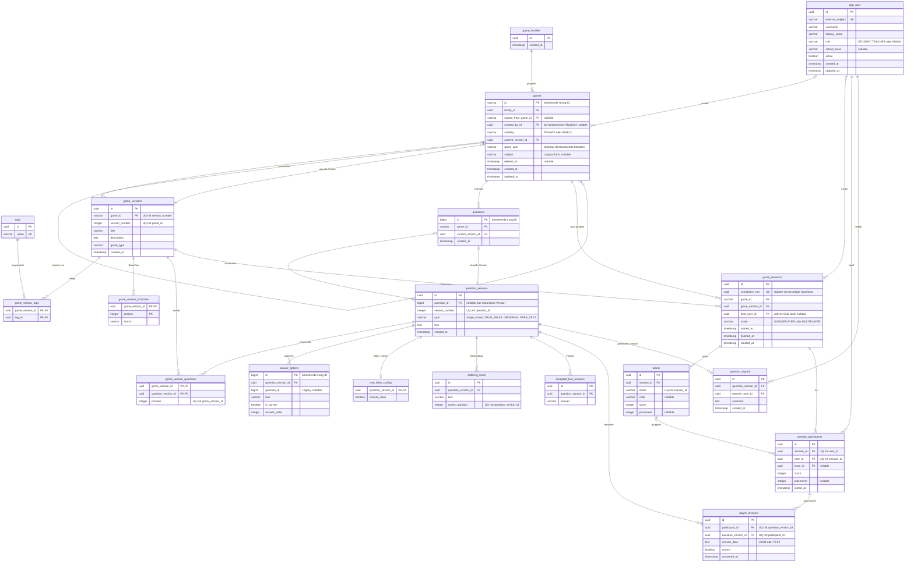

# Datenmodell Version 1 – Mermaid-Entwurf

Stand: 3. November 2026. Aktualisierter fachlicher Entwurf; eine fertige
Datenbank ist damit nicht nachgewiesen. Die Tabellen zu Sessions, Teams, Teilnehmern und Antworten zeigen
ausschließlich dauerhaft gespeicherte, vollständig abgeschlossene Runden.
Lobby, laufende und abgebrochene Runden haben hier keinen Datensatz.

Modellannahme: Beim aktiven Solo-Spiel ist `host_user_id` leer; die allein spielende
Person steht als Teilnehmer in `session_participants`. In einer gehosteten
Mehrspieler-Runde darf der Host nicht zugleich Teilnehmer sein. Nur aktive
Teilnehmer erhalten Fortschritt: Schüler, Lehrkräfte im Singleplayer und
mitspielende Administratoren. Alle Teilnehmer einer abgeschlossenen Runde
erhalten Punkte; Plätze 1 bis 3 deutlich mehr. Punkteformel und Bonus bei einem
Gleichstand an der Grenze zu Platz 3 sind offen. Ein Lobbycode gehört nur zum
flüchtigen Rundenzustand. Ob Lehrkräfte im Mehrspieler-Modus aktiv teilnehmen
dürfen, ist weiterhin offen. Ebenso offen ist, ob ein privates Spiel ohne
Mitspieler gehostet und als Runde abgeschlossen werden kann. Das gezeigte
Ergebnismodell setzt mindestens einen aktiven Teilnehmer voraus; der Host
würde auch in einer reinen Host-Runde nicht selbst mitspielen.

`completion_key` wird serverseitig stabil pro logischer Runde vergeben. Ein
identischer Abschluss-Retry liefert dasselbe Ergebnis, ein abweichender wird
abgewiesen. Finale Teilnehmer- und Teamwerte bleiben gespeichert; Siegerstatus
wird aus Einzel- beziehungsweise Teamplatzierung abgeleitet. Antwortpunkte,
Antwortdauer und eine separate Fortschrittstabelle entfallen.

Neue Spiele sind standardmäßig privat. Vorhandene Spiele werden bei der
Migration öffentlich, auch wenn `created_by_id` mangels belegbarem Ersteller
leer bleibt. Die feste Prüfung der drei Schul-Keycloak-IT-Benutzernamen
`it220269`, `it220240` und `it220265` für `ADMIN` ist geplant; das genaue
Token-Feld ist technisch noch zu verifizieren. Es gibt keine separate
Admin-Anmeldung oder Datenbankvergabe.

Die Sichtbarkeit von Meldungsdetails, Status, Bearbeitungsweg und Empfänger
bleiben offen. Ersteller und Administratoren dürfen die Frage ändern. Beim
Löschen einer gemeldeten Frage verschwinden die aktive Frage und die Meldung;
historische `question_versions` bleiben mit entkoppelbarem `question_id` für
damalige Antworten erhalten. Eine bereits kopierte Spielvorlage bleibt auch
ohne abgeschlossene Session logisch erhalten, damit ihre Herkunftsreferenz
gültig bleibt. Kopierte Fragen benötigen keine Herkunftskette.

| Entity | Aufgabe und Zusammenhang |
|---|---|
| `app_user` | Bestehende UUID-Benutzeridentität und Rolle; Schul-Keycloak bleibt Quelle der Anmeldung und der Rollenregeln. |
| `tags` | Frei benannte Tags, einschließlich übernommener Fachnamen; ein Tag ist weder Spieltyp noch Branch. |
| `game_families` | Fasst ein ursprüngliches Spiel und alle daraus kopierten Varianten zusammen. |
| `games` | Bestehende String-Spielidentität mit Familie, konkretem Spieltyp, Ersteller und aktueller Version. `copied_from_game_id` hält die direkte Vorlage; bei vorhandener Kopie bleibt sie nach Löschung logisch erhalten. |
| `game_versions` | Unveränderlicher Bearbeitungsstand eines Spiels. Eine abgeschlossene Runde verweist auf den gespielten Stand. |
| `game_version_tags` | Ordnet einer Spielversion mehrere Tags und einem Tag mehrere Spielversionen zu. |
| `game_version_branches` | Bewahrt Branch-Werte und ihre Reihenfolge je Spielversion. |
| `questions` | Bestehende Long-Frageidentität innerhalb eines Spiels. Eine Kopie erhält eine unabhängige Identität ohne Herkunfts-Selbstreferenz. |
| `question_versions` | Unveränderlicher Fragetext und Typ; bei Löschung der aktiven Frage bleiben benötigte historische Versionen entkoppelt erhalten. |
| `game_version_questions` | Verbindet Spielversionen mit den verwendeten Frageversionen und legt ihre Reihenfolge fest. |
| `answer_options` | Bestehende Long-Optionen mit Text, Boolean-Richtigkeit und Reihenfolge, einer Frageversion zugeordnet. |
| `true_false_configs` | Ergänzt eine Wahr/Falsch-Frageversion um die richtige Antwort. |
| `ordering_items` | Speichert die Elemente und ihre richtige Reihenfolge für eine Reihenfolge-Frageversion. |
| `accepted_text_answers` | Speichert die akzeptierten Lösungen einer Freitext-Frageversion. |
| `game_sessions` | Vollständig abgeschlossene Runde mit gespielter Version und stabilem `completion_key`; abgebrochene Runden bleiben flüchtig und Retries erzeugen kein zweites Ergebnis. |
| `teams` | Speichert Teams einer abgeschlossenen Runde mit Punkten und Platzierung. Teilnehmer können einem Team zugeordnet sein. |
| `session_participants` | Aktive Spieler mit finalen Punkten und Platzierung als Fortschrittsquelle. Der Host nimmt nicht teil; Siegerstatus ergibt sich aus Einzel- oder Teamplatzierung. |
| `player_answers` | Antwortinhalt, Boolean-Richtigkeit und Antwortzeitpunkt zu einer Frageversion; ohne eigenen Score oder Antwortdauer. |
| `question_reports` | Meldung mit Kommentar und meldender Person an genau einer `question_version_id`; Status und Detailsichtbarkeit bleiben offen. |
